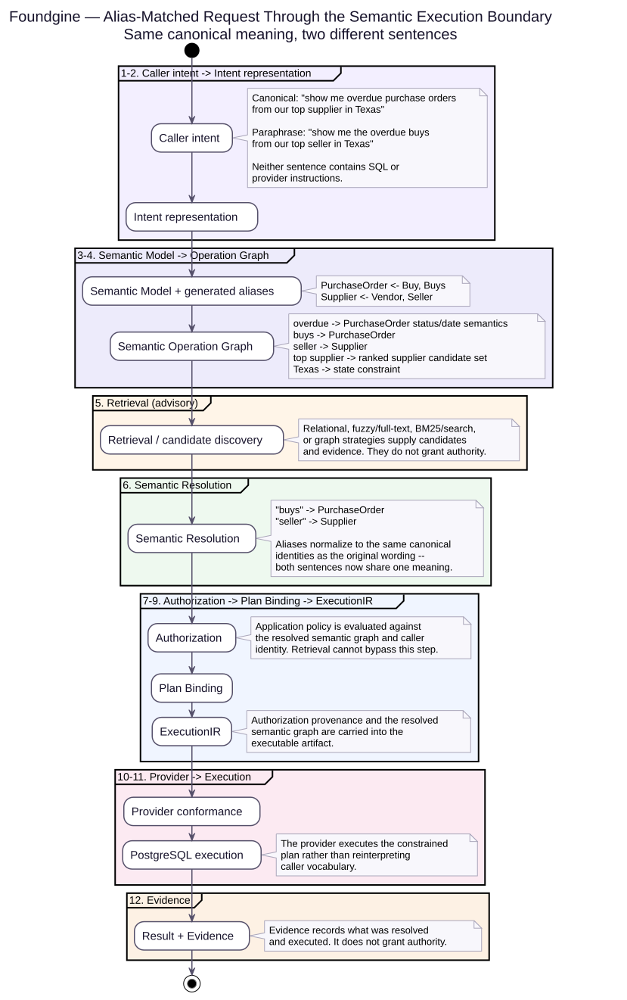

# Example: one request, two wordings

Two callers can ask for the same thing in different words:

- **Canonical:** “show me overdue purchase orders from our top supplier in Texas”
- **Paraphrase:** “show me the overdue buys from our top seller in Texas”

Foundgine does not treat the paraphrase as a fuzzy guess at a _different_ operation. In the Supply Chain semantic contract, `Buy`/`Buys` are declared aliases of `PurchaseOrder`, and `Seller` is a declared alias of `Supplier`. Both sentences are grounded onto the **same canonical semantic identities** before authorization or planning ever runs. The diagram follows one request from words to a database call.

_Tests:_

- .NET — [`SupplyChainGroundingAliasTests.cs`](../src/csharp/samples/Foundgine.SupplyChain.Advanced/Semantic/Tests/Grounding/SupplyChainGroundingAliasTests.cs) (advanced Supply Chain sample) · [`SemanticAliasSynonymGroundingTests.cs`](../src/csharp/tests/Foundgine.Semantics.Tests/SemanticAliasSynonymGroundingTests.cs) (core semantics).
- Java — [`SupplyChainGroundingAliasParityTest.java`](../src/java/samples/foundgine-supply-chain-advanced/src/test/java/com/foundgine/samples/supplychain/advanced/SupplyChainGroundingAliasParityTest.java) (advanced Supply Chain sample) · [`SemanticAliasSynonymGroundingParityTest.java`](../src/java/foundgine-core/src/test/java/com/foundgine/core/semantic/resolution/SemanticAliasSynonymGroundingParityTest.java) (core semantics).

## The request, layer by layer

| #   | Layer                        | What happens |
| --- | ---------------------------- | ------------ |
| 1   | **Caller intent**            | The caller sends either sentence. Neither one contains SQL or provider instructions. |
| 2   | **Intent representation**    | The request becomes structured intent — the caller never constructs a physical query directly. |
| 3   | **Semantic Model**           | The generated contract exposes canonical meanings and their declared aliases: `PurchaseOrder ← Buy, Buys` and `Supplier ← Vendor, Seller`. |
| 4   | **Semantic Operation Graph** | The request becomes application meaning: overdue purchase-order semantics, a ranked “top supplier” relationship, and a `Texas` constraint. |
| 5   | **Retrieval**                | Relational, fuzzy/full-text, BM25/search, or graph strategies propose candidates and evidence. **They never grant authority.** |
| 6   | **Semantic Resolution**      | `buys → PurchaseOrder` and `seller → Supplier`. The aliases normalize to the same canonical identities as the original wording. |
| 7   | **Authorization**            | Application policy runs against the resolved semantic graph and caller identity. Retrieval results cannot bypass this step. |
| 8   | **Plan Binding**             | The authorized decision is bound to a provider-independent execution plan. |
| 9   | **ExecutionIR**              | The executable artifact carries the resolved plan and its authorization provenance across the execution boundary. |
| 10  | **Provider**                 | Only now does a physical provider — PostgreSQL, here — receive the already-authorized artifact. |
| 11  | **Execution**                | The provider executes the constrained plan; it does not reinterpret caller vocabulary. |
| 12  | **Evidence**                 | The result carries evidence of what was resolved and executed. Evidence records what happened — **it does not grant authority.** |

> **The invariant:** alias matching changes vocabulary, not authority. “Buys” does not create a new capability, and “seller” does not create a second supplier meaning — both are application-declared paths to identities that already exist.

## When more than one meaning is legal

Aliases collapse _different words_ onto _one_ meaning. The reverse case, one word with two legal meanings (“active customers”), is covered in [Grounding decisions](GROUNDING-DECISIONS.md) and [Lexical grounding](LEXICAL-GROUNDING.md).
