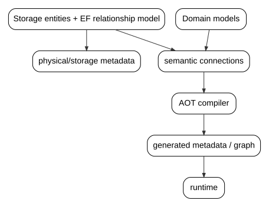
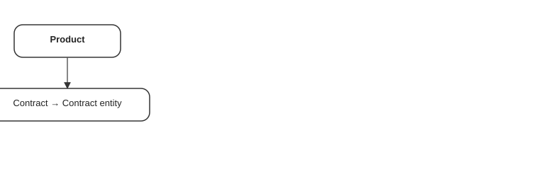
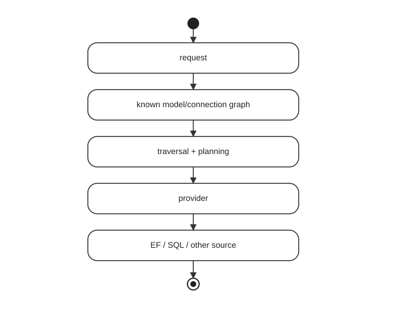

# .NET AOT metadata and connections

This page describes the .NET attribute/source-generator path with EF Core. The Java annotation-processor and JPA path is documented in the [cross-language AOT overview](wiki/aot.md).

The .NET AOT path moves stable domain metadata out of the request path.



## Important boundary

Foundgine does **not** generate or populate entity/model objects.

- EF Core remains the authority for entity schema, keys, foreign keys, and database relationships.
- A Foundgine model describes application-facing data semantics.
- A connection describes that a model can **visit** a known target entity.
- The runtime follows the generated connection; it does not discover the relationship.

This deliberately avoids becoming an object mapper or a second ORM.

## Connections

A model can declare a semantic connection:

```csharp
[FoundgineModel]
public sealed class Product
{
    [FoundgineConnection(typeof(Contract))]
    public Contract Contract => throw new NotSupportedException();
}
```

The property is a declaration of topology. Foundgine never evaluates it and never constructs a `Contract`.

The generator emits:



Relational key details remain on the storage side. This is intentional: a connection says **what may be visited**, while EF/entity metadata says **how the storage relationship exists**.

## Mapping boundary

The current metadata describes entity fields, storage mappings, and explicit semantic connections. It does not make Foundgine an object mapper: it does not generate or populate entity/model objects, and this page does not claim arbitrary C#/LINQ conversion expressions as a supported mapping feature. Keep entity persistence and relationship mechanics in EF Core; use Foundgine metadata to describe the semantic surface exposed to callers.

## Runtime goal



The expensive discovery work belongs in AOT. Runtime should bind request-specific values and execute the already-known topology.

## Generated mapping metadata

Domain-to-persistence mapping models can be emitted as plain C# with `MappingSourceEmitter` (no reflection, deterministic output). That emitter is separate from the Roslyn generator on this page and is work in progress; see [Domain / persistence mapping](DOMAIN-PERSISTENCE-MAPPING.md).

---

Next: [Public API](PUBLIC-API.md)
