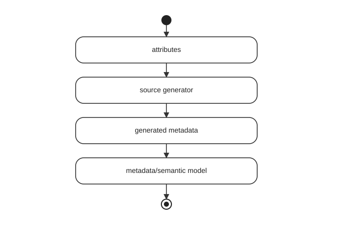
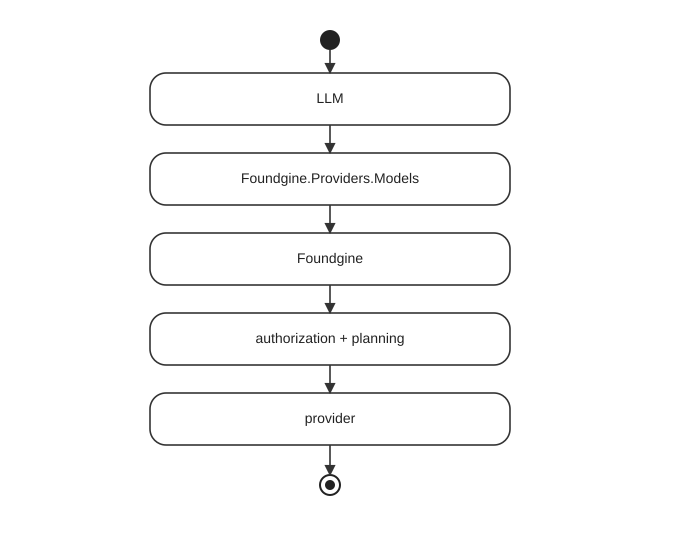

# Getting started

Foundgine has a .NET 10 implementation and a Java 27 implementation. Both follow the same semantic execution architecture; use the language-specific sample and build instructions for the runtime you are adopting.

The quickest way to understand it is to run the repository's Supply Chain sample and then inspect the same pipeline in the `src/` packages. The build section covers both runtimes; the application and adapter code examples below use the .NET 10 API. For Java API examples, start with the linked Java sample READMEs and [`src/java/BUILDING.md`](https://github.com/Foundgine/Foundgine/blob/main/src/java/BUILDING.md).

## Requirements

- .NET: .NET 10 SDK.
- Java: JDK 27 and Apache Maven 3.9 or newer.
- Git.
- Docker Desktop or another Docker-compatible runtime for PostgreSQL-backed integration/sample execution.

## Build and test — .NET

Run these commands from the repository root. The solution is under `src/csharp/`:

```bash
dotnet restore src/csharp/Foundgine.sln
dotnet build src/csharp/Foundgine.sln
dotnet test src/csharp/Foundgine.sln
```

The repository enables nullable reference types and treats warnings as errors. The normal unit suite is designed to run without a database.

## Build and test — Java

Run the Maven reactor from `src/java/`:

```bash
cd src/java
mvn -U clean verify -Dgpg.skip=true
```

The reactor includes the runtime modules, migration tooling, the Redis/Spring Boot/LangChain4j provider implementations, security module and Supply Chain samples. Spring Boot and LangChain4j adapters are compiled into `foundgine-providers`; their framework dependencies are optional. The consolidated Maven build has not been verified in this snapshot. See [`src/java/BUILDING.md`](https://github.com/Foundgine/Foundgine/blob/main/src/java/BUILDING.md) for module-specific commands and the Java ORM/JPA verification plan.

## Run a sample

- .NET: start with the [Supply Chain starter README](https://github.com/Foundgine/Foundgine/blob/main/src/csharp/samples/Foundgine.SupplyChain/README.md).
- Java: start with the [Java Supply Chain starter README](https://github.com/Foundgine/Foundgine/blob/main/src/java/samples/foundgine-supply-chain/README.md).

For PostgreSQL integration tests, see [POSTGRES-E2E.md](POSTGRES-E2E.md).
## First application (.NET)

At minimum an application needs:

1. a semantic model;
2. an authorization policy;
3. a provider plan compiler;
4. an execution provider.

The normal composition is:

```csharp
services.AddFoundgine(options =>
{
    options.Model = model;
    options.AuthorizationPolicy = policy;
});
```

Provider registration is separate.

For application code, inject `IFoundgineExecutor`. It is the intentionally small
entry point and exposes only `ExecuteAsync`. Use `IFoundgine` only for advanced
capability-discovery, dry-run, or approval workflows.

For PostgreSQL, add the SQL provider and register its compiler/execution services according to the application/provider composition.

## A simple query

Typed:

```csharp
var result = await foundgine
    .Query<Customer>()
    .Select(c => new { c.Id, c.Name })
    .Where(c => c.TenantId == tenantId)
    .Take(50)
    .ExecuteAsync();
```

Dynamic:

```csharp
var result = await foundgine
    .Query("Customer")
    .Select("Id", "Name")
    .Where("TenantId", SemanticFilterOperator.Eq, tenantId)
    .Take(50)
    .ExecuteAsync();
```

Both produce the same provider-neutral semantic intent.

## Structural metadata

If the application already has metadata:

```csharp
services.AddFoundgine(options =>
{
    options
        .UseMetadata(metadata)
        .ConfigureSemantics(model =>
        {
            model.Traversal(
                "Customer",
                "transactions",
                "customerRelationships",
                "contract",
                "transactions");
        })
        .ConfigureAuthorization(auth =>
        {
            // application policy
        });
});
```

Metadata supplies structural facts. Semantic configuration supplies application meaning.

To produce that metadata without attributes, configure it fluently and build it once at startup:

```csharp
MetadataRegistry metadata = new SupplyChainModel().Build();   // a FoundgineModel subclass
services.AddFoundgine(options => options.UseMetadata(metadata));
```

The .NET starter uses `SupplyChainModel.Build()`. The Java starter uses its own fluent `FoundgineModelConfiguration<T>` API. See [`MAPPING.md`](MAPPING.md) and the linked language-specific sample READMEs.

## AOT (.NET)

For compile-time metadata, use the `Foundgine.Providers.Aot` declarations with the `Foundgine.Providers.Aot.Generator` build-only analyzer. The AOT declarations are part of `Foundgine.Providers`; the former `Foundgine.Experimental` package is no longer used.



See the [.NET AOT guide](AOT.md) and the [cross-language AOT overview](wiki/aot.md).

## JSON intent (.NET example)

For structured callers:

```csharp
var adapter = new JsonReadIntentAdapter();
var intent = adapter.Parse(json);

var result = await foundgine.ExecuteAsync(intent);
```

Configure `JsonReadIntentAdapterOptions` for public endpoints. The Java runtime also has a JSON intent adapter; see the Java core/provider modules and sample README for its Java API.

## GraphQL (.NET Hot Chocolate)

Use `Foundgine.Extensions.GraphQL.HotChocolate` to translate GraphQL operations into Foundgine semantic intent. Java has a separate GraphQL Java adapter in `foundgine-extensions`; its API is not the Hot Chocolate API.

The same namespace also contains the secure query and mutation executors — `FoundgineHotChocolateQueryExecutor` and `FoundgineHotChocolateMutationExecutor` — that run that intent through the Foundgine authorization/execution boundary.

`Foundgine.Extensions.GraphQL.Http` ([guide](GRAPHQL-HTTP.md)) adds `app.MapFoundgineGraphQL(o => ...)`, a bearer-authenticated `POST /graphql` in front of the query executor (and the mutation executor when `o.AllowMutations` is set). It fails closed: list every query root field and its roles in `o.QueryRootRoles`, and use `o.Authorize` for rules that depend on token claims.

The host owns authentication/security context.

## MCP (.NET example)

`Foundgine.Providers.Tools.MCP` exposes semantic capabilities and intent through MCP.

The host should provide an `ISecurityExecutionContextProvider` backed by authenticated request/session state.

Do not allow MCP arguments to choose tenant, identity, warrant, or provider credentials. Java also has MCP support in `foundgine-providers` and `foundgine-runtime`; see the Java sample README for its host setup.

## AI (.NET Microsoft.Extensions.AI)

`Foundgine.Providers.Models` integrates with `Microsoft.Extensions.AI`; the Microsoft Agent Framework adapter is also included in `Foundgine.Providers`. Java includes LangChain4j and Spring Boot adapters in `foundgine-providers`, with framework dependencies marked optional.

The model can call semantic tools:



The model is an untrusted producer of intent.

For package-specific .NET details, see the `README.md` in each `src/csharp/Foundgine.*` project. For Java module details, see [`src/java/BUILDING.md`](https://github.com/Foundgine/Foundgine/blob/main/src/java/BUILDING.md) and the Java sample READMEs.

---

Next: [Why Foundgine](WHY-FOUNDGINE.md)
