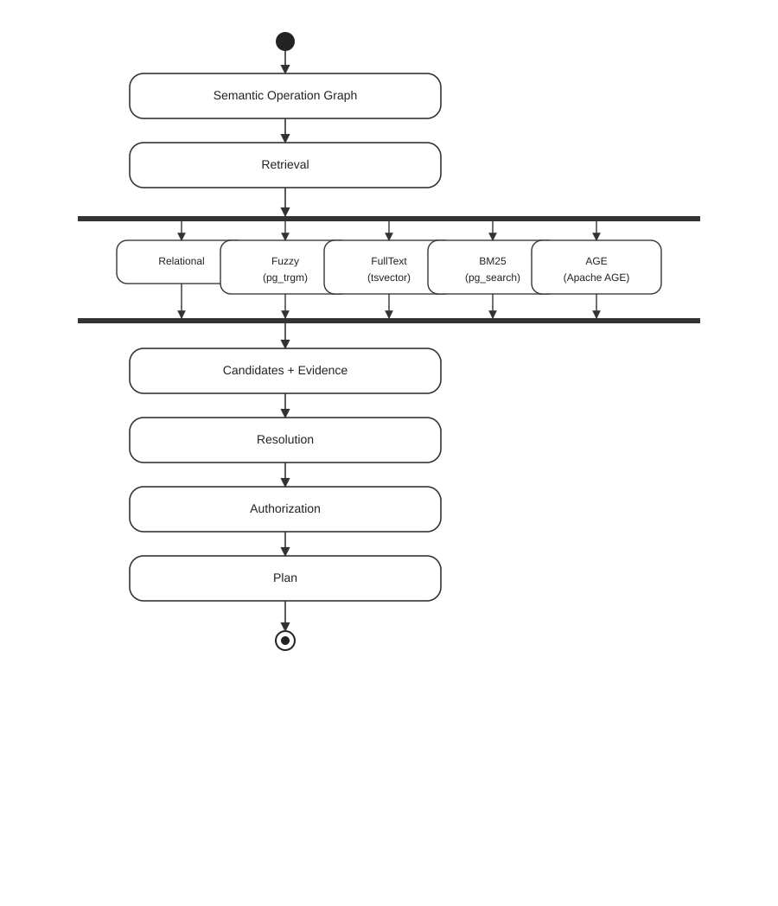
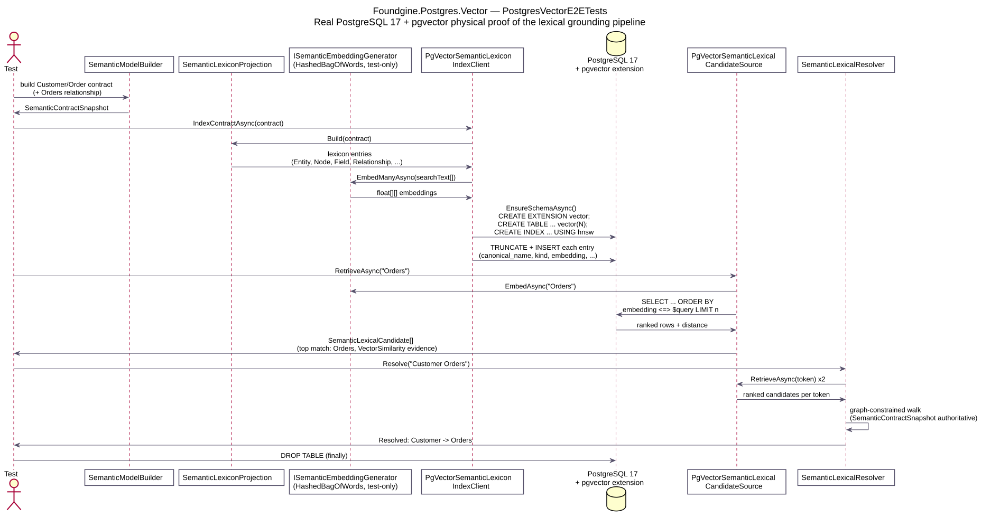

# PostgreSQL 17 E2E

The repository has a real PostgreSQL 17 integration path.

The normal test suite does not require a database. The E2E project's `PostgreSqlFact` / `PostgreSqlTheory` attributes require `FOUNDGINE_POSTGRES_CONNECTION_STRING`. The separate authority-test project's `PostgresFact` attribute accepts either `FOUNDGINE_POSTGRES_CONNECTION` or `FOUNDGINE_POSTGRES_CONNECTION_STRING`.

**CI gap:** the `csharp-build.yml` integration job starts PostgreSQL 17 and invokes the E2E and EventStore projects, but it does not export `FOUNDGINE_POSTGRES_CONNECTION_STRING`. As a result, E2E tests guarded by `PostgreSqlFact` / `PostgreSqlTheory` are skipped even though the database container is running. The separate `security.yml` workflow sets `FOUNDGINE_POSTGRES_CONNECTION` for `Foundgine.Security.Authority.Tests`, but its current filter runs only `TransferFundsPenetrationTests`, not the entire authority test project. Do not treat the current PostgreSQL job as proof that all PostgreSQL-gated tests ran.

## PostgreSQL retrieval in the canonical lifecycle

PostgreSQL retrieval is a branch inside the canonical semantic lifecycle, not a second pipeline:



No retrieval strategy grants authority or bypasses semantic authorization.

## Start PostgreSQL

```bash
docker compose -f docker-compose.postgres.yml up -d
```

Check:

```bash
docker compose -f docker-compose.postgres.yml ps
```

Check the version:

```bash
docker compose -f docker-compose.postgres.yml exec -T postgres \
  psql -U foundgine -d foundgine_e2e -c 'select version();'
```

The container uses:

```text
image: pgvector/pgvector:pg17
host port: 55432
database: foundgine_e2e
user: foundgine
password: foundgine
```

`pgvector/pgvector:pg17` is a drop-in-compatible build of the official `postgres:17` image with the `pgvector` extension preinstalled. It is required by `Foundgine.Providers.Storage.PostgresVector`'s E2E tests (`PostgresVectorE2ETests`), which call `CREATE EXTENSION vector` — something a vanilla `postgres:17` image cannot satisfy.

The compose file uses a named Docker volume (`foundgine-postgres-data`), so data survives container restarts. Use the cleanup command below with `--volumes` to remove it when the test database is disposable.

## Run the tests

PowerShell:

```powershell
$env:FOUNDGINE_POSTGRES_CONNECTION_STRING="Host=localhost;Port=55432;Database=foundgine_e2e;Username=foundgine;Password=foundgine"
dotnet test .\src\csharp\tests\Foundgine.E2E.Tests\Foundgine.E2E.Tests.csproj --configuration Release --filter "FullyQualifiedName~Postgres"
```

Bash:

```bash
export FOUNDGINE_POSTGRES_CONNECTION_STRING='Host=localhost;Port=55432;Database=foundgine_e2e;Username=foundgine;Password=foundgine'
dotnet test src/csharp/tests/Foundgine.E2E.Tests/Foundgine.E2E.Tests.csproj --configuration Release --filter "FullyQualifiedName~Postgres"
```

## What the PostgreSQL tests prove

When these PostgreSQL tests execute and pass, they provide physical database evidence for:

- generated identity correlation;
- dependency levels;
- compiler-owned correlation;
- batched mutation execution;
- real PostgreSQL execution;
- the pgvector-backed lexical grounding pipeline — semantic contract → lexicon projection → embedding → pgvector index → nearest-neighbor retrieval → graph-constrained resolution (`PostgresVectorE2ETests`).

<p align="center"></p>

## Clean up

```bash
docker compose -f docker-compose.postgres.yml down --volumes --remove-orphans
```

## Measurement gate

Do not optimize the PostgreSQL compiler before collecting real PostgreSQL measurements.

The target matrix is:

```text
batch size: 1 / 10 / 50 / 500
depth:      1 / 2 / 3
```

Collect:

```text
planning time
execution time
shared buffer hit/read/write
temporary read/write
WAL bytes
join type
sorts
materialization
estimated rows
actual rows
actual loops
```

The goal is to find the expensive part from the PostgreSQL plan instead of guessing.

---

Next: [Testing](TESTING.md)
