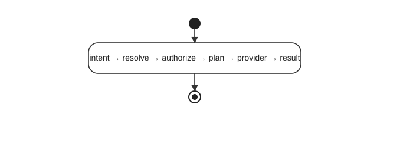

# Testing

Foundgine uses tests to protect architectural boundaries as well as individual APIs.

## Run the test suites

Run the .NET solution from the repository root:

```bash
dotnet build src/csharp/Foundgine.sln
dotnet test src/csharp/Foundgine.sln
```

Run the Java Maven reactor from `src/java/`:

```bash
cd src/java
mvn -U test
```

The .NET Redis and Microsoft Agent Framework adapter tests are part of the solution and reference the consolidated `Foundgine.Providers` project. The Java Spring Boot and LangChain4j adapter sources and tests are compiled as part of `foundgine-providers`; framework dependencies are optional. The latest reported Maven run had the Starter sample passing and the Advanced sample test phase failing; fixes are present but have not been rerun. The PostgreSQL 16 schema-parity test is also not executed by the current PostgreSQL 17 CI job. See [source coverage](SOURCE-COVERAGE.md) and the [Advanced schema audit](https://github.com/CristianBarragan/Foundgine/blob/main/src/java/samples/foundgine-supply-chain-advanced/ADVANCED-SCHEMA-AUDIT.md). These commands describe how to run the suites; they are not evidence that a run passed.

## Test layers

The repository contains tests for the major packages, including:

```text
Abstractions
AOT / generator
Semantics
Metadata
Planning
Execution
SQL
InMemory
GraphQL
MCP
AI
Security.Authority
E2E
```

Exact .NET test project names are visible under `src/csharp/tests/`. Java tests follow Maven convention under each module's `src/test/java/`; see [`src/java/BUILDING.md`](https://github.com/CristianBarragan/Foundgine/blob/main/src/java/BUILDING.md) for module-specific commands.

## What the tests should prove

### Semantics

Test:

- entity/field/relationship resolution;
- invalid references;
- type/value validation;
- pagination validation;
- logical traversal expansion;
- immutable snapshots;
- authorization decisions;
- conditional predicates;
- mutation semantic graphs.

### Planning

Test:

- plan topology;
- provider independence;
- authorization preservation;
- rewrite equivalence;
- aggregate legality;
- deterministic fingerprints;
- provider-cost selection.

### Execution

Test:

- provider boundary;
- execution IR;
- security invariant gates;
- result materialization;
- evidence;
- plan caching;
- mutation dependency execution.

### Providers

Test that a provider:

- compiles the logical plan correctly;
- preserves authorization;
- satisfies required security invariants;
- handles pagination;
- materializes the expected result.

## Security tests

Security tests should assume transports are hostile.

Important cases include:

```text
caller requests denied field
caller traverses denied relationship
caller tries to cross tenant boundary
caller supplies forged authority context
provider drops authorization predicate
cached plan loses runtime context
mutation executes without required approval/security proof
```

The expected result is rejection, not widened access.

## PostgreSQL tests

PostgreSQL integration tests are separate from the database-free suite.

See [POSTGRES-E2E.md](POSTGRES-E2E.md).

## Deterministic testing

Prefer tests that assert semantic/plan contracts rather than exact SQL formatting when the SQL text is not the behavior under test.

For provider tests, exact SQL assertions are appropriate where SQL generation itself is the subject.

## Test the boundary, not implementation trivia

A strong Foundgine test generally follows:



This is more valuable than testing an internal helper in isolation when the helper's only purpose is to support the pipeline.

## Regression discipline

When fixing a bug:

1. add a focused failing test;
2. fix the owning layer;
3. run the affected package tests;
4. run the full suite;
5. run PostgreSQL E2E when the change crosses the SQL/provider boundary.

Do not fix a semantic bug inside a transport adapter merely because that is where the failure was first observed.

---

Next: [Source coverage](SOURCE-COVERAGE.md)
